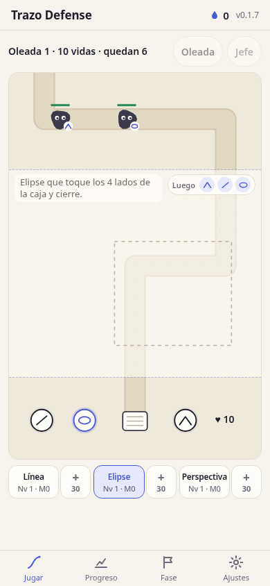

# ✏️ Trazo Defense

> Tower defense para aprender a dibujar: cada torre dispara con un ejercicio de dibujo medido de forma objetiva.

**[▶ Jugar ahora](https://juliangdeveloper.github.io/trazo-defense/)** · gratis, en el navegador, sin instalar



## Cómo se juega

- Los monstruos salen por arriba y bajan hacia tu cuaderno, abajo. Dibujas sobre el campo, en la franja entre ellos y la base, y la torre activa dispara.
- Mientras dibujas, los monstruos van en cámara lenta. «Luego» muestra los próximos ejercicios.
- **Línea:** une los dos puntos de un solo trazo. Se mide desviación, extremos, repasos y velocidad.
- **Elipse:** dibújala dentro de la caja. Se mide ajuste, cierre y temblor.
- **Perspectiva:** cierra un cubo en perspectiva de un punto con 3 rectas hacia el punto de fuga. Se mide la convergencia en grados, el cierre en las esquinas y la rectitud.
- Las tres torres están disponibles desde el inicio. En una oleada los monstruos mezclan técnicas y el que va primero elige la torre y el ejercicio.
- Mejor trazo, más daño. Cada resultado muestra sus métricas.
- **Mejoras:** cada torre está en el campo con su nivel y un botón + con el costo en tinta; en una oleada también se mejora tocando la torre. Son 5 niveles que alternan más daño y más objetivos, y la torre cambia de aspecto. El daño sigue dependiendo del puntaje del trazo.
- **Jefe:** con los mínimos del capítulo 1 cumplidos, dibuja horizonte, cara frontal y líneas de fuga para romper sus 4 puntos débiles.
- La primera oleada que terminas cada día da tinta extra. No hay rachas ni se pierde nada.
- El tutorial se puede repetir desde Ajustes.

## Stack

HTML, CSS y JavaScript con módulos ES, sin dependencias. Funciona sin conexión con service worker y guarda el progreso en `localStorage`.

```bash
python3 -m http.server 8080
```

---

Más proyectos: https://juliangdeveloper.github.io/

Hecho con ❤️ y ✏️
