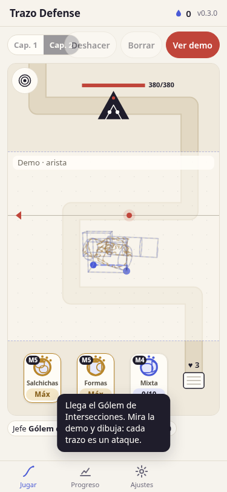

# ✏️ Trazo Defense

> Tower defense para aprender a dibujar: cada torre dispara con un ejercicio de dibujo medido de forma objetiva.

**[▶ Jugar ahora](https://juliangdeveloper.github.io/trazo-defense/)** · gratis, en el navegador, sin instalar



## Cómo se juega

- Los monstruos salen por arriba y bajan hacia tu cuaderno, abajo. Dibujas sobre el campo, en la franja entre ellos y la base, y la torre activa dispara.
- Mientras dibujas, los monstruos van en cámara lenta. «Luego» muestra los próximos ejercicios.
- **Capítulo 1**
  - **Línea:** une los dos puntos. Se mide desviación, extremos, repasos y velocidad.
  - **Elipse:** dibújala dentro de la caja. Se mide ajuste, cierre y temblor.
  - **Perspectiva:** cierra un cubo en un punto de fuga con 3 rectas. Se mide convergencia, cierre y rectitud.
- **Capítulo 2** (se abre al vencer al jefe del 1 y cumplir sus mínimos; puedes volver al 1 desde Progreso o Ajustes)
  - **Flecha:** dibuja los dos bordes de una cinta que se curva y se encoge con la distancia. Se mide suavidad, encogimiento y solape.
  - **Salchicha:** dibuja 2 elipses de contorno sobre la forma. Lo clave es que el eje menor de cada elipse siga el eje central.
  - **Caja 2p:** cierra una caja rotada con 4 rectas hacia dos puntos de fuga. Se mide convergencia, cierre y rectitud.
- Las tres torres del capítulo activo están disponibles desde el inicio. En una oleada los monstruos mezclan técnicas y el que va primero elige la torre y el ejercicio.
- Mejor trazo, más daño. Cada resultado muestra sus métricas.
- **Mejoras:** cada 10 de tinta la torre de menor nivel del capítulo activo sube sola. Son 5 niveles que alternan más daño y más objetivos.
- **Jefe cap. 1:** Guardián del Punto de Fuga. Horizonte, cara frontal, 4 fugas y una elipse. Demo con «Ver demo».
- **Jefe cap. 2:** Gólem de Intersecciones. Caja en 2 puntos, cilindro que la atraviesa y la línea de intersección. Las guías (VPs y eje) cambian en cada aparición.
- **Ataques al jefe:** cada ataque se califica en Precisión, Rectitud, Seguridad, Proporción y Presión (4 niveles). Al cerrar llega el ataque final y los puntos débiles rotos quitan más.
- **Destello:** 5 anillos sobre el jefe; el color es el nivel. La leyenda está en el campo o en Ajustes.
- La primera oleada que terminas cada día da tinta extra. No hay rachas.
- El tutorial se puede repetir desde Ajustes.
- Con lápiz óptico el grosor sigue la presión; la medición usa siempre los puntos originales del trazo.
- **Deshacer** quita el último trazo en práctica y contra el jefe (devuelve la vida que ese ataque le quitó).

## Stack

HTML, CSS y JavaScript con módulos ES. Funciona sin conexión con service worker y guarda el progreso en `localStorage`.
Al abrirse guarda el progreso en `localStorage` (`meta.v1.trazo-defense`), que lee el [portafolio](https://juliangdeveloper.github.io/).

```bash
python3 -m http.server 8080
```

## Créditos

Trazos dibujados con [perfect-freehand](https://github.com/steveruizok/perfect-freehand) de Steve Ruiz, licencia MIT, incluido sin cambios en `js/vendor/perfect-freehand/` con su `LICENSE`.

---

Más proyectos: https://juliangdeveloper.github.io/

Hecho con ❤️ y ✏️
